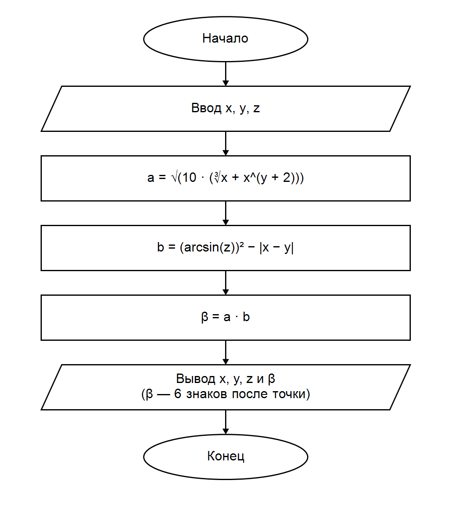

# Домашка к 5 лабе

### Вариант 6

Вычислить значение выражения:

$$
\beta = \sqrt{10\left(\sqrt[3]{x}+x^{y+2}\right)}\cdot\left((\arcsin z)^2-|x-y|\right)
$$

Вывод: написана программа на C для вычисления выражения. При x = 0.01655, y = −2.75, z = 0.15 получено β = −40.630694. В контрольном примере задания указан плюс, но по данной формуле результат отрицательный.
